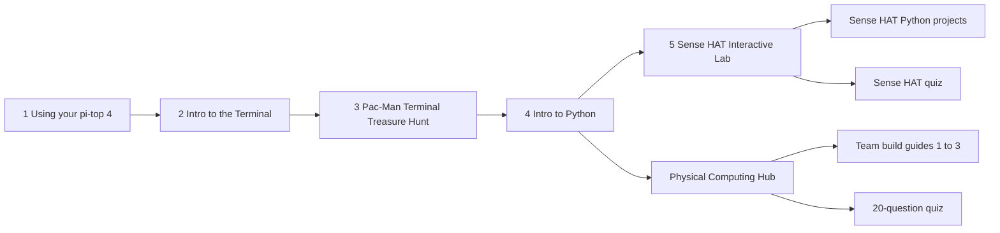

# TechTopia

Classroom materials for the **TechTopia Industry Challenge** on physical computing. The repository combines:

- interactive HTML lessons that teach students from first power-on to Python and the Sense HAT,
- curriculum, quiz and team build-guide pages for the showcase challenge, and
- four small Raspberry Pi **Sense HAT** Python projects with automated tests.

## Where do I start?

| I am a... | Start here |
|---|---|
| **Student** new to the pi-top [4] | [Intro lessons](TechTopia_Industry_Challenge_Intro_Lessons_SenseHat/), in order 1 to 5 |
| **Student** in a showcase team | Your team guide in [`03_Showcase_Team_Guides/`](TechTopia_Industry_Challenge_Physical_Computing_Materials/03_Showcase_Team_Guides/) |
| **Teacher** planning a unit | [Physical Computing Hub](TechTopia_Industry_Challenge_Physical_Computing_Materials/01_Curriculum_Websites/TechTopia_Physical_Computing_Hub.html), then the [quizzes](TechTopia_Industry_Challenge_Physical_Computing_Materials/02_Student_Assessment/) |
| **Student or teacher** wanting Sense HAT programs to run or extend | [Sense HAT projects](#sense-hat-python-projects) below |
| **Contributor** | [`CONTRIBUTING.md`](CONTRIBUTING.md), then [`docs/repository-guide.md`](docs/repository-guide.md) |

## Suggested learning path



The numbered lessons are designed to be taken in order. The Sense HAT track (Lab 5 and the Python projects) and the pi-top component track (Hub and team guides) can be done in either order after lesson 4.

## Repository layout

| Folder | What it is | Hardware / SDK |
|---|---|---|
| [`TechTopia_Industry_Challenge_Intro_Lessons_SenseHat/`](TechTopia_Industry_Challenge_Intro_Lessons_SenseHat/) | Five interactive HTML lessons: pi-top [4] basics, terminal, terminal treasure hunt, Python, Sense HAT lab | pi-top [4]; `sense_hat` in lesson 5 |
| [`TechTopia_Industry_Challenge_Physical_Computing_Materials/`](TechTopia_Industry_Challenge_Physical_Computing_Materials/README.txt) | Curriculum hub, two quizzes, and three team build guides | `pitop` SDK (LED, Button, Buzzer, LightSensor, SoundSensor, Potentiometer) |
| [`sensehat_compass/`](sensehat_compass/README.md) | Joystick-controlled compass: arrow, cardinal and numeric heading modes | Sense HAT |
| [`sensehat_maze_joystick/`](sensehat_maze_joystick/README.md) | Marble maze controlled by joystick or by tilting the board | Sense HAT |
| [`sense_hat_arcade/`](sense_hat_arcade/README.md) | Arcade with 3 games, three difficulty levels and persistent high scores | Sense HAT |
| [`sense_hat_arcade 2/`](sense_hat_arcade%202/README.md) | "Enhanced Edition" arcade with 6 games, countdown and session-only best scores | Sense HAT |

Everything is self-contained: there is no shared code, no build step and no dependency file. The two arcade folders are different codebases, not versions of one program.

### Classroom materials in detail

**Intro lessons** (open in a browser):

1. Using Your pi-top [4]
2. Introduction to the Terminal
3. Pac-Man Terminal Treasure Hunt
4. Intro to Python
5. Sense HAT Interactive Lab

**Challenge materials**:

- `01_Curriculum_Websites/`: Physical Computing Hub (concepts, project library, coding constructs, glossary)
- `02_Student_Assessment/`: 20-question physical computing quiz; Sense HAT getting-started quiz
- `03_Showcase_Team_Guides/`: Team 1 Smart Security System, Team 2 Reaction Challenge, Team 3 Smart Crosswalk (each has wiring, roles, checklist, build steps and final code)

## Sense HAT Python projects

### Requirements

- Python 3 (standard library only for logic and tests).
- To run on hardware: a Raspberry Pi with a Sense HAT and the `sense-hat` package (`sudo apt install sense-hat`).

### Run the tests (any computer)

Tests use `unittest` and need no Sense HAT. Run every project's tests from the repository root:

```bash
python3 run_tests.py
```

The same script runs in CI on every push and pull request (`.github/workflows/tests.yml`).

To run one project, work inside its folder, because modules import each other by bare name:

```bash
cd sensehat_compass            # or any other project folder
python3 -m unittest discover -v
```

Run a single test:

```bash
cd sensehat_compass
python3 -m unittest -v test_compass.CompassTests.test_cardinal_boundaries
```

Running `unittest discover` from the repository root finds no tests.

### Run the programs (Raspberry Pi with Sense HAT)

| Project | Command |
|---|---|
| Compass | `python3 compass_app.py` |
| Maze | `python3 marble_maze.py` |
| Arcade | `python3 arcade.py` |
| Arcade 2 | `python3 run_on_pi.py` |

Press Ctrl+C to quit. Controls are described in each project's README.

### Design: hardware-free core, thin hardware shell

Logic lives in modules that never import `sense_hat`, so it is testable anywhere. Only the runner talks to the hardware.

| Project | Testable logic | Hardware runner |
|---|---|---|
| `sensehat_compass` | `compass_core.py` | `compass_app.py` |
| `sensehat_maze_joystick` | `maze_logic.py`, `controls.py` | `marble_maze.py` |
| `sense_hat_arcade` | `arcade_core.py`, `high_scores.py` | `arcade.py` |
| `sense_hat_arcade 2` | `arcade.py` | `run_on_pi.py` |

`arcade.py` is the hardware runner in `sense_hat_arcade` but the pure game logic in `sense_hat_arcade 2`.

Shared conventions:

- A display frame is a flat list of 64 `(r, g, b)` tuples; the pixel at column `x`, row `y` is index `y*8 + x`.
- Joystick handlers ignore every event whose `action` is not `'pressed'`.
- Tests fake joystick events with `types.SimpleNamespace(direction=..., action='pressed')`.
- Game classes accept an optional `seed` or `rng` so behaviour is repeatable in tests.
- After a blocking `show_message`, runners call `sense.stick.get_events()` to discard presses made during the scroll.
- Runners set `sense.low_light = True` and call `sense.clear()` on exit.

## Known limitations

- The Python projects have not been tested on physical Sense HAT hardware. Check LED orientation, timing, joystick events and sensor readings on the device.
- The Python snippets in the challenge materials target pi-top [4] hardware and were carried forward from class materials; validate SDK component names, ports and sensor ranges before classroom use.
- The materials folder has no embedded pi-top photos or TechTopia background images.

## Licensing

This repository is licensed under [CC BY-SA 4.0](LICENSE) because its materials are assumed to be adapted from [Raspberry Pi Foundation](https://www.raspberrypi.org) learning resources, which use that license. You may share and adapt it, but you must give credit, indicate changes, and license derivatives under CC BY-SA 4.0. Some content was drafted with AI tools. See [`NOTICE.md`](NOTICE.md) for the attribution text, caveats and sources table.

## More documentation

- [`docs/repository-guide.md`](docs/repository-guide.md): groupings, proposed folder structure and information-architecture recommendations
- [`CONTRIBUTING.md`](CONTRIBUTING.md): onboarding, conventions and how to add a project or lesson
- `docs/` and [`mkdocs.yml`](mkdocs.yml): MkDocs site source. Preview with `pip install mkdocs-material && mkdocs serve`.
- Entry pages for the HTML content: [intro lessons](TechTopia_Industry_Challenge_Intro_Lessons_SenseHat/index.html) and [challenge materials](TechTopia_Industry_Challenge_Physical_Computing_Materials/index.html).
