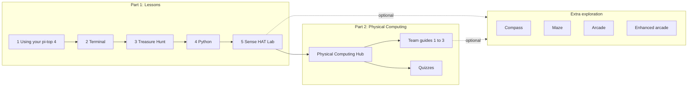

# TechTopia

**Website: <https://jln1028.github.io/TechTopia/>**

Classroom materials for the **TechTopia Industry Challenge** on physical computing. The course has two parts, plus optional extension activities:

| Part | What | Folder |
|---|---|---|
| **Part 1: Lessons** | Five interactive HTML lessons, from first power-on to Python and the Sense HAT | [`TechTopia_Industry_Challenge_Intro_Lessons_SenseHat/`](TechTopia_Industry_Challenge_Intro_Lessons_SenseHat/) |
| **Part 2: Physical Computing** | Bridges the Sense HAT into physical computing with external components: curriculum hub, quizzes, and three team build guides | [`TechTopia_Industry_Challenge_Physical_Computing_Materials/`](TechTopia_Industry_Challenge_Physical_Computing_Materials/README.txt) |
| **Extra exploration** | Four example Sense HAT games and apps written in Python, to read, run and modify | [Sense HAT Python examples](#extra-exploration-sense-hat-python-examples) |

## Where do I start?

| I am a... | Start here |
|---|---|
| **Student** | Part 1: [intro lessons](TechTopia_Industry_Challenge_Intro_Lessons_SenseHat/), in order 1 to 5. Then Part 2 (physical computing). |
| **Student** building a team project | Your team guide in [`03_Showcase_Team_Guides/`](TechTopia_Industry_Challenge_Physical_Computing_Materials/03_Showcase_Team_Guides/) (after Part 1) |
| **Student** who finishes early or wants more | [Extra exploration](#extra-exploration-sense-hat-python-examples) |
| **Teacher** planning the course | The [course flow](#course-flow) below, then the [Physical Computing Hub](TechTopia_Industry_Challenge_Physical_Computing_Materials/01_Curriculum_Websites/TechTopia_Physical_Computing_Hub.html) |
| **Contributor** | [`CONTRIBUTING.md`](CONTRIBUTING.md), then [`docs/repository-guide.md`](docs/repository-guide.md) |

## Course flow



Part 1 is taken in order. Part 2 follows it and moves from the Sense HAT to physical computing with external components. The Python examples are optional extension activities for students who want to go further with the Sense HAT; nothing in Parts 1 or 2 depends on them.

## Repository layout

| Folder | Course role | What it is | Hardware / SDK |
|---|---|---|---|
| [`TechTopia_Industry_Challenge_Intro_Lessons_SenseHat/`](TechTopia_Industry_Challenge_Intro_Lessons_SenseHat/) | Part 1 | Five interactive HTML lessons: pi-top [4] basics, terminal, terminal treasure hunt, Python, Sense HAT lab | pi-top [4]; `sense_hat` in lesson 5 |
| [`TechTopia_Industry_Challenge_Physical_Computing_Materials/`](TechTopia_Industry_Challenge_Physical_Computing_Materials/README.txt) | Part 2 | Bridges the Sense HAT into physical computing: curriculum hub, two quizzes, and three team build guides | `pitop` SDK (LED, Button, Buzzer, LightSensor, SoundSensor, Potentiometer) |
| [`sensehat_compass/`](sensehat_compass/README.md) | Extra | Joystick-controlled compass: arrow, cardinal and numeric heading modes | Sense HAT |
| [`sensehat_maze_joystick/`](sensehat_maze_joystick/README.md) | Extra | Marble maze controlled by joystick or by tilting the board | Sense HAT |
| [`sense_hat_arcade/`](sense_hat_arcade/README.md) | Extra | Arcade with 3 games, three difficulty levels and persistent high scores | Sense HAT |
| [`sense_hat_arcade 2/`](sense_hat_arcade%202/README.md) | Extra | "Enhanced Edition" arcade with 6 games, countdown and session-only best scores | Sense HAT |

Everything is self-contained: there is no shared code, no build step and no dependency file. The two arcade folders are different codebases, not versions of one program.

### Part 1 and Part 2 in detail

**Part 1: intro lessons** (open in a browser, take in order):

1. Using Your pi-top [4]
2. Introduction to the Terminal
3. Pac-Man Terminal Treasure Hunt
4. Intro to Python
5. Sense HAT Interactive Lab

**Part 2: physical computing materials**:

- `01_Curriculum_Websites/`: Physical Computing Hub (concepts, project library, coding constructs, glossary)
- `02_Student_Assessment/`: 20-question physical computing quiz; Sense HAT getting-started quiz
- `03_Showcase_Team_Guides/`: Team 1 Smart Security System, Team 2 Reaction Challenge, Team 3 Smart Crosswalk (each has wiring, roles, checklist, build steps and final code)

## Extra exploration: Sense HAT Python examples

Four complete example programs for students who want to explore further after lesson 5. Each is a working Sense HAT game or app written in Python. Students can run them, read the code, and change them (for example colours, speed, difficulty or controls). They are not required for the challenge.

Each example has a ready-made activity sheet with four steps: **run it, predict and change it, read the tests, extend it**. See [`docs/activities.md`](docs/activities.md) (also on the [website](https://jln1028.github.io/TechTopia/activities/)).

Suggested activities:

- Run one example on the Sense HAT and describe how the joystick controls it.
- Change a value (a colour, a speed, a difficulty setting) and predict the effect before running it.
- Read a test file and explain what behaviour it checks.
- Add a small feature, for example a new compass mode or a new maze.

### Requirements

- Python 3 (standard library only for logic and tests).
- To run on hardware: a Raspberry Pi with a Sense HAT and the `sense-hat` package (`sudo apt install sense-hat`).

### Run the tests (any computer)

Tests use `unittest` and need no Sense HAT. Run every project's tests from the repository root:

```bash
python3 run_tests.py
```

The same script runs in CI on every push and pull request (`.github/workflows/tests.yml`).

To run one project, work inside its folder, because modules import each other by bare name:

```bash
cd sensehat_compass            # or any other project folder
python3 -m unittest discover -v
```

Run a single test:

```bash
cd sensehat_compass
python3 -m unittest -v test_compass.CompassTests.test_cardinal_boundaries
```

Running `unittest discover` from the repository root finds no tests.

### Run the programs (Raspberry Pi with Sense HAT)

| Project | Command |
|---|---|
| Compass | `python3 compass_app.py` |
| Maze | `python3 marble_maze.py` |
| Arcade | `python3 arcade.py` |
| Arcade 2 | `python3 run_on_pi.py` |

Press Ctrl+C to quit. Controls are described in each project's README.

### Design: hardware-free core, thin hardware shell

Logic lives in modules that never import `sense_hat`, so it is testable anywhere. Only the runner talks to the hardware.

| Project | Testable logic | Hardware runner |
|---|---|---|
| `sensehat_compass` | `compass_core.py` | `compass_app.py` |
| `sensehat_maze_joystick` | `maze_logic.py`, `controls.py` | `marble_maze.py` |
| `sense_hat_arcade` | `arcade_core.py`, `high_scores.py` | `arcade.py` |
| `sense_hat_arcade 2` | `arcade.py` | `run_on_pi.py` |

`arcade.py` is the hardware runner in `sense_hat_arcade` but the pure game logic in `sense_hat_arcade 2`.

Shared conventions:

- A display frame is a flat list of 64 `(r, g, b)` tuples; the pixel at column `x`, row `y` is index `y*8 + x`.
- Joystick handlers ignore every event whose `action` is not `'pressed'`.
- Tests fake joystick events with `types.SimpleNamespace(direction=..., action='pressed')`.
- Game classes accept an optional `seed` or `rng` so behaviour is repeatable in tests.
- After a blocking `show_message`, runners call `sense.stick.get_events()` to discard presses made during the scroll.
- Runners set `sense.low_light = True` and call `sense.clear()` on exit.

## Known limitations

- The Python projects have not been tested on physical Sense HAT hardware. Check LED orientation, timing, joystick events and sensor readings on the device.
- The Python snippets in the Part 2 materials target pi-top [4] hardware and were carried forward from class materials; validate SDK component names, ports and sensor ranges before classroom use.
- The materials folder has no embedded pi-top photos or TechTopia background images.

## Licensing

Different parts use different licenses (details in [`LICENSE.md`](LICENSE.md) and [`NOTICE.md`](NOTICE.md)):

| Content | License |
|---|---|
| Intro lessons, curriculum hub, team guides (adapted from [Raspberry Pi Foundation](https://www.raspberrypi.org) projects [Getting started with the Sense HAT](https://projects.raspberrypi.org/en/projects/getting-started-with-the-sense-hat) and [Physical Computing with Python](https://projects.raspberrypi.org/en/projects/physical-computing)) | [CC BY-SA 4.0](LICENSE-CC-BY-SA-4.0.txt): credit the Foundation, indicate changes, share adaptations under the same license |
| Python projects, test runner, CI and site config | [MIT](LICENSE-MIT.txt) |
| Quizzes and documentation | [CC BY 4.0](LICENSE-CC-BY-4.0.txt) |

The Python projects and quizzes were drafted with AI tools without reference material.

## More documentation

- [`docs/repository-guide.md`](docs/repository-guide.md): groupings, proposed folder structure and information-architecture recommendations
- [`CONTRIBUTING.md`](CONTRIBUTING.md): onboarding, conventions and how to add a project or lesson
- [`docs/activities.md`](docs/activities.md): activity sheets for the four Python examples
- `docs/` and [`mkdocs.yml`](mkdocs.yml): MkDocs site source. Preview with `pip install mkdocs-material && mkdocs serve`.
- Entry pages for the HTML content: [intro lessons](TechTopia_Industry_Challenge_Intro_Lessons_SenseHat/index.html) and [Part 2 materials](TechTopia_Industry_Challenge_Physical_Computing_Materials/index.html).
