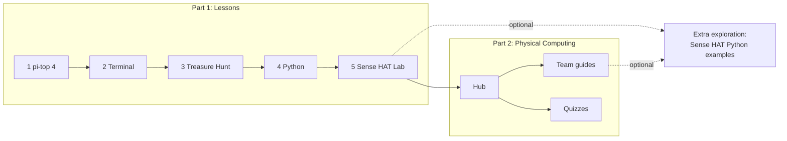

# TechTopia

Classroom materials for the **TechTopia Industry Challenge** on physical computing: Part 1 lessons, Part 2 physical computing, and optional Sense HAT Python examples for extra exploration.

## The course

| Part | What | Page |
|---|---|---|
| **Part 1: Lessons** | Five interactive lessons, in order | [Lessons](lessons.md) |
| **Part 2: Physical Computing** | Bridges the Sense HAT into physical computing with external components: hub, quizzes, team guides | [Physical Computing](physical-computing.md) |
| **Extra exploration** | Four example Sense HAT games and apps in Python, with activity sheets | [Extra exploration](projects.md), [activity sheets](activities.md) |

Teachers: see [Getting started](getting-started.md). Contributors: see [CONTRIBUTING on GitHub](https://github.com/jln1028/TechTopia/blob/main/CONTRIBUTING.md).

## Course flow

!!! note "Hardware"
    The Python projects and the `pitop` snippets in Part 2 have been run on pi-top hardware by the maintainer. There is no formal test log, so check them on your own hardware before classroom use.
