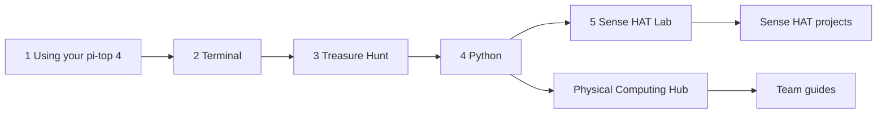

# TechTopia

Classroom materials for the **TechTopia Industry Challenge** on physical computing: interactive lessons, curriculum and team build guides, and four Raspberry Pi Sense HAT Python projects.

## Choose your path

| I am a... | Go to |
|---|---|
| Teacher | [Getting started](getting-started.md) |
| Student new to the pi-top [4] | [Learn: intro lessons](lessons.md) |
| Student in a showcase team | [Challenge materials](challenge.md) |
| Looking for Sense HAT programs | [Sense HAT projects](projects.md) |
| Contributor | [CONTRIBUTING on GitHub](https://github.com/jln1028/TechTopia/blob/main/CONTRIBUTING.md) |

## Learning path

!!! warning "Hardware verification"
    The Python projects have not been tested on a physical Sense HAT, and the `pitop` snippets in the challenge materials have not been validated on a device. Check them on your hardware before classroom use.
